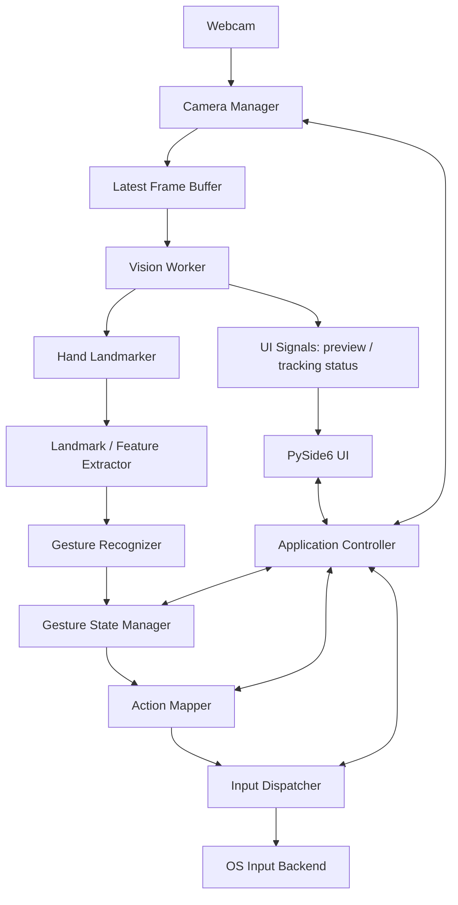

# HandPilot — Product, Architecture & Build Specification

> **Purpose:** Build a Windows-first desktop app that turns webcam-based hand gestures into mouse and selected keyboard actions. This document is the project source of truth for the AI coding agent and human contributors.

## 1. Product definition

**HandPilot** is a local, privacy-first, real-time hand-gesture controller. It captures webcam frames, detects hand landmarks, recognizes deliberate gestures, and sends safe input events to the operating system.

### Primary user outcome
A user can launch HandPilot, enable tracking, move the cursor with one hand, click, drag, scroll, pause, and stop without touching a physical mouse.

### Product principles
- Local processing by default; no account, cloud service, or network connection required at runtime.
- Low latency and predictable behavior matter more than having many gestures.
- Never issue an action from a single noisy frame. Validate gestures over time.
- Vision, gesture interpretation, OS input, and UI must be separate modules.
- Keep the first release small, testable, accessible, and easy to package.

## 2. Scope

### MVP — required
1. Start/stop webcam capture and show a live preview.
2. Detect and track one hand using 21 hand landmarks.
3. Move the system cursor with the index fingertip.
4. Perform a left click with a quick thumb-index pinch.
5. Perform a double-click through two quick, valid pinch clicks.
6. Drag by holding a pinch beyond a configurable hold threshold; release the pinch to release the mouse button.
7. Scroll while a dedicated two-finger scroll pose is active.
8. Pause/resume tracking with a deliberate open-palm pose or the UI.
9. Provide a keyboard emergency stop (default `Esc`) and always release held buttons on shutdown, tracking loss, or error.
10. Provide calibration, sensitivity/smoothing settings, status feedback, and local configuration persistence.

### Not in MVP
- Voice control, cloud processing, user accounts, gesture-model training, multiple simultaneous hands, Linux/macOS support, arbitrary macro execution, or full keyboard replacement.
- Do not add features outside the MVP unless they are needed for reliability or the user explicitly requests them.

### Default gesture map
| Gesture | Action | Notes |
|---|---|---|
| Index finger extended; other fingers relaxed | Move cursor | Use index fingertip landmark; movement only while tracking is enabled. |
| Quick thumb-index pinch and release | Left click | Trigger once on release; use threshold hysteresis and a cooldown. |
| Two quick pinch clicks | Double-click | Use configurable click interval; avoid generating an extra single-click action. |
| Thumb-index pinch held past drag threshold | Drag | Mouse-down after hold threshold; move while held; mouse-up on release. |
| Index + middle extended, remaining fingers folded | Scroll mode | Vertical hand movement controls scroll; no click while scroll mode is active. |
| Open palm held steadily | Pause/resume | Require a stable pose and explicit state transition; avoid toggling repeatedly. |
| `Esc` key | Emergency stop | Immediately disable gesture input and release all held buttons. |

**Gesture design rule:** A fist is not the default click gesture because it is easy to confuse with other poses and can create accidental clicks. Gesture mappings must be configurable later, but the safe defaults above take priority.

## 3. Platform and technology decisions

| Area | Choice | Guidance |
|---|---|---|
| Initial OS | Windows 10/11 | Keep OS-specific code behind an input-backend interface. |
| Language | Python | Use type hints and small modules. |
| Desktop UI | PySide6 | UI updates must run on the Qt main thread. |
| Camera / frame processing | OpenCV (`cv2`) | Start with 640×480 at a target of about 30 FPS; make settings configurable. |
| Hand landmarks | MediaPipe Hand Landmarker Tasks API | Pin a tested version and model asset; do not mix legacy Solutions examples with Tasks API code. |
| Numerics | NumPy | Coordinate and distance calculations. |
| Initial input backend | PyAutoGUI | Wrap it behind an interface; keep a path open for Windows `SendInput` later. |
| Configuration | JSON | Store preferences locally; validate values and recover from invalid config. |
| Tests | pytest | Unit-test logic with synthetic landmarks and a mocked input backend. |
| Packaging | PyInstaller | Produce a Windows build after a reproducible development setup exists. |

Do not assume package versions or MediaPipe APIs from memory. Check current official documentation when installing, then pin the exact versions that work together in the lock/requirements file. Keep the hand-landmarker model file in a documented, license-compliant location; do not silently download files at runtime.

## 4. Architecture



### Component responsibilities

**Camera Manager**
- Open, configure, read, and release the webcam.
- Detect unavailable/disconnected cameras and report errors cleanly.
- Never block the UI thread.

**Latest Frame Buffer**
- Keep at most the newest frame (for example, queue size 1); discard stale frames instead of building latency.
- Protect shared frame access safely.

**Vision Worker / Hand Landmarker**
- Process frames off the UI thread.
- Return normalized landmarks, handedness, timestamp, and tracking confidence/status.
- Do not move the mouse or execute gestures.

**Landmark / Feature Extractor**
- Calculate fingertip positions, finger extension states, pinch distances, and motion features.
- Keep coordinates normalized to 0..1 until mapping to screen space.
- Isolate geometry functions so they can be unit-tested without a webcam.

**Gesture Recognizer**
- Convert features over multiple frames into candidate gestures.
- Use explicit activation/release thresholds (hysteresis), minimum stable-frame/time requirements, and confidence checks.
- Output typed gesture events; do not call OS APIs.

**Gesture State Manager**
- Own states such as `DISABLED`, `TRACKING`, `PAUSED`, `CURSOR`, `SCROLL`, and `DRAGGING`.
- Resolve priority/conflicts. Scroll mode suppresses click recognition; drag suppresses scroll.
- Handle hand loss, stale frames, cooldowns, pause/resume, and safe release of held buttons.

**Coordinate Mapper / Smoother**
- Map the calibrated camera region to the full screen, clamp to screen bounds, and account for mirrored preview consistently.
- Apply configurable exponential smoothing; expose sensitivity and smoothing settings.
- Keep mapping independent of gesture recognition and OS input.

**Action Mapper**
- Translate validated gesture events into abstract commands such as `MOVE`, `LEFT_CLICK`, `RIGHT_CLICK`, `MOUSE_DOWN`, `MOUSE_UP`, and `SCROLL`.
- Do not execute commands directly.

**Input Dispatcher / OS Input Backend**
- Serialize input commands in one place to avoid concurrent mouse operations.
- Provide an interface such as `move`, `click`, `button_down`, `button_up`, `scroll`, and `release_all`.
- The controller must track held buttons and call `release_all()` on stop, exception, application exit, or prolonged tracking loss.
- Keep keyboard actions allowlisted; do not implement arbitrary command or shell execution.

**Application Controller / PySide6 UI**
- Own start/stop lifecycle and connect components using Qt signals/slots or thread-safe queues.
- Update widgets only on the main thread.
- Show camera status, hand detected/lost, current mode/gesture, and errors.
- Provide Start/Stop, Pause/Resume, calibration, sensitivity, smoothing, and camera selection controls.

## 5. Runtime and threading model

Use a small, understandable concurrency model:
1. **UI thread:** Qt event loop, widgets, settings, and status display.
2. **Camera worker:** captures frames and writes the newest frame to a bounded latest-frame buffer.
3. **Vision worker:** reads the newest frame, runs hand tracking, computes features/gesture events, and publishes results.
4. **Input dispatcher:** serializes validated OS input commands. It may be a worker or a carefully isolated service, but must never block the UI.

Use Qt signals/slots or thread-safe queues for communication. Never update Qt widgets from background threads. Avoid unbounded queues and avoid processing old frames after a delay. Use monotonic timestamps for gesture durations and click intervals.

## 6. Core behavior and algorithms

### Hand landmarks
MediaPipe provides 21 landmarks per detected hand. Key indices: wrist 0, thumb tip 4, index tip 8, middle tip 12, ring tip 16, pinky tip 20. Verify handedness and preview mirroring before using coordinates.

### Pinch distance
Use normalized landmark distance, not raw pixels:

`distance = sqrt((x4 - x8)^2 + (y4 - y8)^2)`

Use separate pinch-start and pinch-release thresholds. Tune them in testing rather than hard-coding a universal value. A quick pinch-release is a click; a pinch held beyond a configurable duration becomes a drag. Release the mouse button as soon as pinch release or safety cancellation is detected.

### Cursor mapping
- Use a configurable inner camera region as the active control area.
- Normalize and clamp the index fingertip to that region, then map to screen coordinates.
- Apply smoothing such as `smoothed = alpha * current + (1 - alpha) * previous`.
- Reset smoothing on re-acquisition, calibration changes, or large discontinuities to prevent cursor jumps.
- Support multi-monitor only after single-monitor behavior is reliable.

### Click / double-click
- A click is emitted once after a valid short pinch is released.
- Two valid clicks inside a configurable interval become a double-click at the same approximate cursor location.
- Ensure the double-click implementation does not also emit unwanted independent single clicks if the chosen design can defer classification. Document the selected behavior.
- Add cooldown and a minimum release/open interval to prevent repeated triggering.

### Scroll
- Enter scroll mode only after the scroll pose is stable for a short configurable duration.
- Convert vertical hand displacement into scroll steps with sensitivity and dead-zone controls.
- Exit scroll mode when the pose is released or tracking is lost.

### Tracking loss and safety
- If the hand is lost or frames become stale, stop cursor movement and new actions immediately.
- If dragging, release the mouse button immediately.
- On any exception or shutdown, call `release_all()` before closing the backend.
- `Esc` must stop gesture control even if the camera is still running.
- No click/drag/scroll action may execute when the app is disabled or paused.

## 7. Project structure

```text
handpilot/
├── AGENTS.md
├── HANDPILOT_SPEC.md
├── README.md
├── requirements.txt
├── pyproject.toml                 # optional; use for tool/test configuration
├── main.py
├── app/
│   ├── application.py
│   ├── app_controller.py
│   ├── config.py
│   └── events.py
├── camera/
│   ├── camera_manager.py
│   └── frame_buffer.py
├── vision/
│   ├── hand_landmarker.py
│   ├── landmark_features.py
│   └── coordinate_mapper.py
├── gestures/
│   ├── recognizer.py
│   ├── gesture_rules.py
│   └── state_manager.py
├── input_control/
│   ├── backend.py
│   ├── pyautogui_backend.py
│   ├── dispatcher.py
│   └── action_mapper.py
├── ui/
│   ├── main_window.py
│   ├── camera_view.py
│   ├── dashboard.py
│   └── settings_dialog.py
├── utils/
│   ├── smoothing.py
│   └── logging_config.py
├── tests/
│   ├── test_landmark_features.py
│   ├── test_gesture_recognizer.py
│   ├── test_state_manager.py
│   ├── test_coordinate_mapper.py
│   └── test_input_dispatcher.py
└── assets/
    └── models/                    # documented MediaPipe model asset, if used
```

Do not create empty modules just to match this tree. Add files when their responsibility is implemented. Keep names consistent and update this tree if the design changes.

## 8. Configuration

Persist a small validated JSON configuration under the user's application config directory, not in the source tree. Suggested settings:
- camera index and resolution;
- preview mirroring;
- cursor sensitivity and smoothing;
- active control-region margins;
- pinch start/release thresholds;
- drag hold duration;
- double-click interval;
- gesture stability duration and cooldown;
- scroll sensitivity and dead zone;
- emergency-stop key.

Provide safe defaults. If config is missing or invalid, restore defaults and show a non-fatal notice. Do not store camera frames or biometric templates.

## 9. UI requirements

MVP window should include:
- Start / Stop control;
- Pause / Resume control;
- live camera preview with optional landmark overlay;
- clear status: camera ready/error, hand detected/lost, current mode;
- sensitivity and smoothing controls;
- calibration action and simple calibration guidance;
- gesture reference/help panel;
- emergency-stop help text.

Use a clean, accessible layout. Keep the preview responsive and avoid rendering every captured frame if the UI cannot keep up.

## 10. Non-functional requirements

- **Responsiveness:** target 30 FPS camera capture where hardware allows; optimize for low end-to-end latency. Treat numeric latency/FPS values as measured targets, not guarantees.
- **Reliability:** never leave a mouse button held after stop, tracking loss, exception, or shutdown.
- **Privacy:** process frames locally and in memory; do not record, upload, or log raw frames by default.
- **Maintainability:** type hints, docstrings for public interfaces, clear module boundaries, structured logging, and pinned dependencies.
- **Portability:** isolate OS input calls so other platforms can be added later; MVP is Windows-first.
- **Accessibility:** provide a physical keyboard stop/pause option and controls that do not require gesture input.

## 11. Testing and acceptance criteria

### Automated tests
- Landmark geometry: pinch distance and finger-state helpers on synthetic landmarks.
- Gesture recognition: stable pose, unstable pose, threshold crossing, release, cooldown, and tracking loss.
- State manager: no conflicting click/scroll/drag actions; correct pause/disable transitions.
- Coordinate mapping: corners, center, clamping, mirroring, and calibration boundaries.
- Input dispatcher: commands serialized; `release_all()` called on errors and shutdown.
- UI/controller: use mocks; do not require a physical webcam in unit tests.

### Manual MVP acceptance checklist
- [ ] App starts and stops the webcam cleanly.
- [ ] Live preview and hand landmarks are visible when a hand is detected.
- [ ] Index finger moves the cursor smoothly within the calibrated area.
- [ ] Quick pinch creates exactly one left click.
- [ ] Two quick pinches are recognized as a double-click according to the documented policy.
- [ ] Held pinch starts dragging and release stops dragging.
- [ ] Scroll pose scrolls without clicking.
- [ ] Open palm pauses without repeated toggling.
- [ ] `Esc` immediately disables control.
- [ ] Removing the hand stops movement and safely releases held buttons.
- [ ] Camera disconnection and exceptions do not crash the UI or leave buttons held.
- [ ] The app works without a network connection after dependencies/model assets are installed.

## 12. Implementation sequence

Build incrementally; do not generate the entire application in one pass.

**Phase 0 — Inspect and plan**
- Inspect the repository and machine/runtime assumptions.
- Confirm Windows target, Python version compatibility, MediaPipe Tasks API, model asset source/license, and dependency versions from current official documentation.
- Create a concise implementation plan and identify risks before coding.

**Phase 1 — Vertical slice: webcam + tracking**
- Create environment and dependency file.
- Implement camera manager and hand landmarker.
- Show preview and landmarks in a minimal PySide6 window.
- Validate camera cleanup and hand-loss status.

**Phase 2 — Cursor only**
- Implement feature extraction, calibration, coordinate mapping, and smoothing.
- Add a safe Start/Stop toggle and `Esc` emergency stop.
- Use a mock input backend for tests before enabling real cursor control.

**Phase 3 — Click and drag**
- Implement pinch thresholds, click-on-release, double-click timing, drag hold, and guaranteed release.
- Test false positives and tracking-loss cases.

**Phase 4 — Scroll and pause**
- Implement scroll pose, dead zone, pause/resume, and conflict priorities.

**Phase 5 — Settings, hardening, packaging**
- Add config persistence, error handling, logging, performance measurements, and manual acceptance tests.
- Package with PyInstaller only after the source build is stable.

At the end of every phase: run tests, manually verify the relevant behavior, update README/spec if necessary, and report changed files, commands run, results, known issues, and the next smallest step.

## 13. Agent working rules

1. Read this specification before implementation and treat it as the source of truth.
2. First inspect the existing repository; do not overwrite or reorganize unrelated files.
3. Work in small, verifiable phases. Do not scaffold every future module at once.
4. Before adding a dependency or using an API, verify current compatibility and explain the choice briefly.
5. Prefer the simplest maintainable solution. No unnecessary abstractions, frameworks, cloud services, databases, or ML training.
6. Keep real OS input disabled by default during development. Use a mock backend until the safety tests pass; require an explicit UI enable action for live control.
7. Never run destructive shell commands, change system settings, install global packages, or request administrator privileges without explicit approval.
8. Do not capture, store, upload, or expose camera frames. Do not log sensitive frame data.
9. Add or update tests for every meaningful behavior change. Do not claim tests pass unless they were run and passed.
10. If a requirement is ambiguous, make a conservative, reversible choice, document it, and continue. Ask only when a decision blocks safe implementation.
11. Keep code typed, readable, modular, and beginner-friendly. Explain complex choices in plain language.
12. After each task, summarize what changed, how to run/test it, results, and remaining risks. Do not claim the full project is complete when only a phase is done.

## 14. Definition of MVP done

The MVP is done only when all manual acceptance checks in Section 11 pass on the target Windows machine, automated tests pass, the app can be started/stopped safely, and setup/run instructions are documented. A visually attractive UI alone is not completion.
